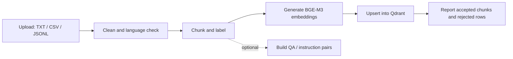
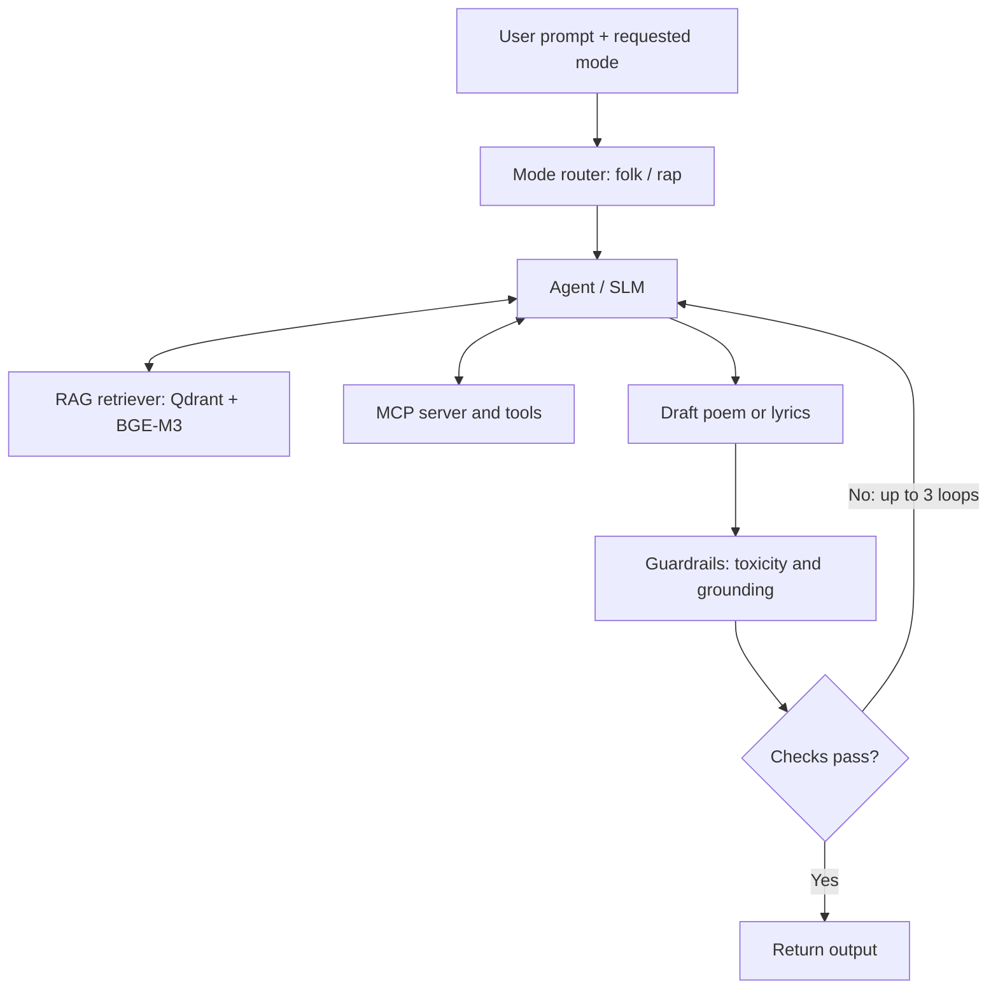

# Milestone 2 — Proposed Architecture

## Transylvanian Folk & Rap Dual-Mode Creative Agent

**Course:** LLM/SLM Applications  
**Team:** Platinum Records  
**Status:** Proposed architecture — design commitments for Weeks 6–14

---

## 1. Problem and Data

### 1.1 Problem Definition

The project addresses the difficulty of generating Romanian creative text that uses Transylvanian vocabulary, idioms, regional context, and appropriate poetic structure consistently.

The system accepts:
- A user prompt describing the desired topic or meaning.
- A requested mode: **folk** or **rap**.

It produces a poem or rap lyrics that preserve the user's intended meaning while applying regional vocabulary and the structural characteristics of the selected mode.

The system combines a small language model (SLM), retrieval-augmented generation (RAG), and tools exposed through a Model Context Protocol (MCP) server. A commercial model is retained only as an evaluation baseline.

### 1.2 Data Sources and Intended Use

The proposed data is divided into four categories:

| Data Category | Candidate Sources / Content | Intended Use |
|---|---|---|
| Folk material | Transylvanian folk collections, including Pop-Reteganul and Jarník & Bârseanu; public-domain poetry candidates including Coșbuc, Blaga, and Goga | Regional knowledge base and style/context examples for RAG; selected material may support training where permitted |
| Dialect knowledge | Dialect lexicons, idiom lists, dexonline and regional glossaries | Retrieval of regional words, meanings, and usage examples |
| Rap material | Original lyrics written by the team and AI-generated lyrics reviewed by humans | Rap examples and task-specific training data |
| Instruction pairs | Prompt-to-poem and prompt-to-lyrics examples, including human-reviewed synthetic examples | Fine-tuning data |

#### 1.2.1 Initial Dataset Source Inventory

The following sources have been identified as candidates for the initial dataset. Their availability, initial licensing information, and intended use are recorded below.

| Source | Data Type | Availability | Initial Licensing Status | Intended Use |
|---|---|---|---|---|
| *Doine și strigături din Ardeal* — Jarník & Bârseanu (1895) | Folk songs and traditional verses | PDF available through BCU Cluj | Public domain according to the library catalogue | Primary folk RAG corpus |
| *Chiuituri de care strigă flăcăii la joc* — Ion Pop-Reteganul (1887) | Traditional verses and regional expressions | Listed on Wikisource; full-text availability to be checked | Original work is public domain; digital edition to be checked | Additional folk material |
| George Coșbuc's poetry | Romanian poetry, rhyme and poetic structure | Online collections available | Original works are public domain; specific editions to be checked | Poetic structure and style examples |
| dexonline | Regional vocabulary and definitions | Online dictionary | Automated extraction requires permission; individual dictionary rights vary | Dialect reference; RAG only if permitted |
| Regional glossaries | Transylvanian words, idioms and expressions | Specific collections to be selected | Not yet verified | Dialect RAG corpus |
| Team-written rap lyrics | Original rap verses | To be created by the team | Original team-owned material, subject to third-party rights | Fine-tuning |
| AI-generated, human-reviewed examples | Folk and rap instruction pairs | To be generated and reviewed | Provider terms and originality to be checked | Fine-tuning |

**Source references:**

- Jarník & Bârseanu — *Doine și strigături din Ardeal*: https://dspace.bcucluj.ro/handle/123456789/78863
- Ion Pop-Reteganul — Wikisource: https://ro.wikisource.org/wiki/Autor:Ion_Pop-Reteganul
- George Coșbuc — Wikisource: https://ro.wikisource.org/wiki/Autor:George_Co%C8%99buc
- dexonline: https://dexonline.ro
- dexonline licensing information: https://radu.dexonline.ro/~radu/DEX/www/licenta

The preferred initial folk source is *Doine și strigături din Ardeal*, because it contains authentic Transylvanian folk material and is available as a downloadable PDF with a public-domain designation.

**Source and licensing validation:** Before ingestion, the team will record the exact source URL, content type, license/rights status, approximate size, and whether the material can be used for retrieval, training, or both. Sources with unclear licensing will not be included until their permitted uses have been confirmed.

#### 1.2.2 Rap Dataset Strategy

The proposed rap dataset will combine two types of material:

1. **Original lyrics written by the team:** Romanian rap verses incorporating Transylvanian vocabulary, regional themes, and different rhyme patterns.
2. **AI-generated lyrics reviewed by humans:** Synthetic examples generated from prompts specifying a theme, rhyme scheme, and regional vocabulary. These examples will be checked for language quality, coherence, and originality.

The team will avoid copying commercially released rap lyrics without appropriate permission.

Each fine-tuning example will contain a user prompt and a corresponding reviewed output, together with metadata such as mode, theme, rhyme scheme, source type, and review status.

This strategy provides task-specific training examples while reducing copyright risks and allowing the team to control the quality of the data.

The strategy is proposed for confirmation by the full team before dataset creation.

#### 1.2.3 Initial Data Collection Plan

The initial data collection will take place in Week 7, starting with a sample of approximately **50–100 text fragments**.

The planned steps are:

1. **Select suitable sources:** Prioritise public-domain folk collections and original team-written material. Use dialect resources only when the relevant permissions are confirmed.
2. **Collect text fragments:** Extract representative folk stanzas, traditional expressions, regional vocabulary entries, and original rap verses.
3. **Record source information:** Create `sources.csv` containing source identifiers, titles, URLs, licensing information, intended use, and collection notes.
4. **Store raw data:** Save the collected material in `data/raw/`, preserving original text and source references.
5. **Clean the dataset:** Implement `clean.py` to normalise Romanian diacritics, remove duplicates, and reject empty or invalid records.
6. **Prepare structured data:** Save the cleaned fragments in `data/processed/chunks.jsonl`, using the metadata format defined in Section 1.3.
7. **Validate the results:** Check text quality, regional relevance, and source traceability before the dataset is used by the RAG pipeline.

The exact distribution of folk, dialect, and rap fragments will depend on source availability and licensing validation.

**Expected Week 7 deliverables:**

- `data/raw/` — initial collection of 50–100 text fragments.
- `sources.csv` — source inventory and licensing information.
- `clean.py` — text cleaning and duplicate removal script.
- `data/processed/chunks.jsonl` — cleaned and structured dataset.

The collection plan follows the cleaning and ingestion pipeline described in Sections 1.3 and 1.4.

### 1.3 Data Cleaning and Metadata

The planned cleaning process includes:
- Normalising Romanian diacritics without changing the intended wording.
- Removing duplicate records.
- Checking language and rejecting invalid or empty records.
- Assigning labels such as `mode`, `theme`, `rhyme_scheme`, and `region`.
- Preserving source and license information.

The proposed record format is JSONL. Each record should contain at least:

```json
{
  "id": "unique-record-id",
  "text": "Romanian text",
  "mode": "folk",
  "source": "source-name",
  "region": "Transylvania",
  "license": "verified-license-or-status"
}
```

Additional metadata may include author, theme, rhyme scheme, word type, register, and source-specific information.

### 1.4 Ingesting New Datasets

Users should be able to add a new corpus without modifying the application code. The proposed ingestion flow is:



The same pipeline will be used to populate the initial knowledge base and to ingest later datasets.

The planned interfaces are:
- A command-line entry point.
- An `ingest_dataset` MCP tool.

The ingestion report will include the number of processed chunks and rejected rows.

---

## 2. Golden Dataset

The team will create a representative evaluation dataset containing approximately **100 items**, stored at:

`data/eval/golden_v1.jsonl`

The planned distribution is:

| Task Category | Approximate Number | Expected Answer Format |
|---|---:|---|
| Dialect questions and retrieval | 40 | Correct explanation/answer or expected retrieved chunk IDs |
| Folk generation | 30 | Reference example and/or explicit generation constraints |
| Rap generation | 30 | Reference example and/or explicit generation constraints |
| **Total** | **100** | |

### 2.1 Creation and Validation

- The team will write representative prompts covering both creative modes and dialect-related tasks.
- Two native Transylvanian Romanian speakers will review the examples.
- Each item will include an expected answer, expected chunk IDs, or explicit acceptance constraints, depending on the task.
- Evaluation items will be kept separate from fine-tuning pairs and will not be added to the retrieval corpus when doing so would cause test leakage.
- A development split will be available for tuning; a locked test split of 30% will be reserved for final evaluation.
- The first draft is planned for Week 7, and Golden Dataset v1 is planned to be frozen in Week 8.

### 2.2 Example Item

```json
{
  "id": "g-017",
  "task": "generation",
  "mode": "folk",
  "prompt": "poezie despre mama care coace pâine",
  "constraints": {
    "scheme": "ABAB",
    "syllables": 8,
    "dialect_terms_min": 2
  },
  "expected_chunks": ["folk-231"],
  "reference": "(reference verse written and reviewed by the team)"
}
```

For open-ended generation, the reference is not intended to be the only acceptable output. The constraints and evaluation rubric will also be used to assess generated responses.

---

## 3. RAG Design

### 3.1 Chunking Strategy

The project will chunk data by semantic and creative units rather than using one fixed token length for every source.

| Source Type | Chunk Unit | Metadata |
|---|---|---|
| Folk poems | One stanza, with one-stanza overlap | Author, region, theme, rhyme scheme |
| Rap lyrics | A verse of 4–8 lines (bar group) | Style tags, tempo, themes |
| Dialect lexicon | One entry: word, meaning, and example | Word type, region, register |
| Idioms and sayings | One saying and its explanation | Topic, tone |

A stanza, verse, or dictionary entry is intended to preserve the meaning and structural information needed for retrieval. Metadata will allow filtering by mode (folk or rap) before ranking.

### 3.2 Vector Database

**Proposed choice: Qdrant.**

Reasons:
- Supports metadata filtering.
- Supports the planned hybrid retrieval approach.
- Can be run locally using Docker.

Alternatives considered:

| Option | Advantages | Limitations Considered |
|---|---|---|
| Qdrant — selected | Metadata filters, hybrid search, local Docker setup | Requires running an additional service |
| Chroma | Simple to start with | Less suitable for the planned hybrid search and filtering requirements |
| FAISS | Fast and does not require a server | Does not provide its own metadata store |

### 3.3 Embedding Model

**Primary candidate: BGE-M3.**

It is a multilingual embedding model selected for Romanian-language retrieval and its support for dense and sparse representations, which can support hybrid search.

**Fallback candidate: multilingual-e5.**

It will be considered if BGE-M3 causes memory or resource constraints. The two embedding options will be compared on a retrieval test set rather than assuming that one is better.

### 3.4 RAG Approaches to Compare

All retrieval approaches will be evaluated using the same evaluation queries and relevance criteria.

| Strategy | Planned Method | Expected Benefit |
|---|---|---|
| Mode-filtered retrieval | Filter chunks by folk or rap mode | Reduce mixing of styles |
| Hybrid search | Combine dense and sparse/BM25 signals | Improve retrieval of rare dialect words |
| Re-ranking | Reorder the top 20 retrieved chunks using a cross-encoder | Improve top-result relevance |
| Query rewriting | Use the SLM to expand a prompt with relevant regional terms | Improve recall |
| Two-pass retrieval | Retrieve vocabulary first and style examples second | Provide richer context |

The experiments will compare retrieval relevance and the effect of retrieved context on generated output. The planned experiments and weeks are listed in `timeline.md`.

---

## 4. Agent and Tools

### 4.1 Agent Workflow

The agent receives the prompt and requested mode, decides what context and checks are needed, generates a draft, and uses tools to verify it.

If a check fails, the agent can revise the draft using the returned feedback, with a maximum of three revision loops.



### 4.2 Decisions Made by the Agent

The agent is expected to make four main decisions for each request:

**1. Which mode is requested?**
- Select folk or rap.
- If the mode is unclear, ask the user for clarification.
- Unsafe requests are refused.

**2. What context should be retrieved?**
- Choose retrieval filters such as mode and theme.
- Decide how many chunks are needed.
- Retrieval may be skipped if regional context is unnecessary.

**3. Which checks should run?**
- Select syllable, rhyme, dialect, and meaning checks based on the requested mode and the draft's needs.

**4. Should the draft be accepted or revised?**
- Use tool feedback to revise a failing draft, up to three loops.
- If toxicity or ungrounded dialect claims remain, refuse or soften the output.

### 4.3 MCP Tools

The planned standalone MCP server will expose the following tools:

| Tool | Responsibility |
|---|---|
| `syllable_counter` | Count syllables per line |
| `rhyme_checker` | Check rhyme scheme and rhyme quality |
| `dialect_lookup` | Find regional words and their meanings |
| `retrieve_context` | Retrieve context from RAG, with mode filtering |
| `meaning_check` | Compare the generated output with the original prompt's intent |
| `ingest_dataset` | Add a new corpus through the ingestion pipeline |

### 4.4 MCP Exposure Plan

The tools will be exposed through a standalone MCP server implemented in Python using the MCP Python SDK and stdio transport.

Each tool will have:
- A typed input schema.
- A defined result.
- A clear description of its purpose.

An MCP-compatible client/agent will discover the available tools and invoke them as required.

The standalone design is intended to allow other MCP clients to reuse the tools.

The architecture describes the planned interface; implementation and testing will be completed incrementally according to the project timeline.

---

## 5. Model Choices

The project compares three system configurations:

| Configuration | Description | Purpose |
|---|---|---|
| A. Commercial baseline | Commercial LLM accessed through an API | Reference point for measuring the quality gap |
| B. Untuned SLM | Candidate 3–4B instruction model, with the same RAG and tools | Isolate the contribution of retrieval and tools before fine-tuning |
| C. Fine-tuned SLM | The selected base SLM fine-tuned on project data using QLoRA | Intended final system; adapt generation to the target style and dialect |

### 5.1 Candidate Models

The current candidates identified by the team are Qwen, Gemma, and RoLlama in the 3–4B class where suitable variants are available.

The exact model IDs and versions will be fixed after checking:
- Model availability.
- License terms.
- Hardware requirements.
- Comparison on the same prompts.

The commercial model is an evaluation baseline, not the intended final system.

### 5.2 Fine-tuning Approach

The planned approach is QLoRA with 4-bit quantisation and rank `r=16`, trained using Colab or another available GPU environment.

Planned instruction tasks:
- Prompt to folk poem.
- Prompt to rap verse.
- Dialect question answering (meaning of regional words).
- Tool-call format for the agent.

The team will compare the base and fine-tuned model on held-out data.

The evaluation will include perplexity and judged output quality.

If fine-tuning cannot be completed with the available resources, the stated fallback is a prompt-tuned SLM.

---

## 6. Evaluation and Safety

The project will evaluate structure, creative quality, meaning preservation, and safety.

| Dimension | Planned Evaluation |
|---|---|
| Structure | Syllable accuracy per line and rhyme-scheme match rate, checked using MCP tools |
| Dialect quality | Authenticity rated by native speakers on a 1–5 scale |
| Meaning preservation | LLM judge and human sample comparing output with the original prompt |
| System comparison | Compare commercial baseline (A), untuned SLM (B), and fine-tuned SLM (C) |
| Toxicity | Apply a toxicity filter to generated output and regenerate if flagged |
| Grounding / hallucination | Check that dialect claims are consistent with retrieved entries |
| Unsafe requests | Refuse hateful or offensive requests |

The Golden Dataset will provide a repeatable basis for comparing system configurations and retrieval experiments.

---

## 7. Implementation Plan

The week-by-week implementation commitments, experiments, outputs, and role ownership are maintained in the companion file `timeline.md`.

The main milestones are:
- Week 6: Architecture and plan uploaded to GitHub.
- Weeks 7–8: Data ingestion, Qdrant, initial Golden Dataset, and RAG baseline.
- Week 9: Lab progress check with an agent loop and three tools.
- Weeks 10–11: Fine-tuning and remaining tools.
- Week 12: GitHub progress review.
- Week 13: Final evaluation, documentation, and code freeze.
- Week 14: Final presentation, 15-minute demo, documentation, and source code.

---

## 8. Open Decisions to Resolve

The following points remain to be confirmed or validated as the project progresses:

1. Final licensing verification and permitted uses for the candidate sources listed in Section 1.2.1.
2. Team confirmation of the proposed rap dataset strategy: original team-written lyrics combined with AI-generated, human-reviewed examples.
3. Exact SLM model IDs and versions after resource and license checks.
4. Final embedding choice after the BGE-M3 versus multilingual-e5 retrieval experiment.
5. Final RAG configuration after the planned retrieval experiments.

These decisions will be recorded in the repository as the project progresses.
